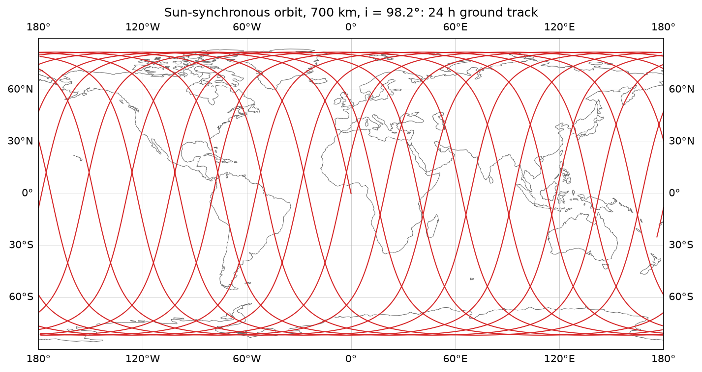
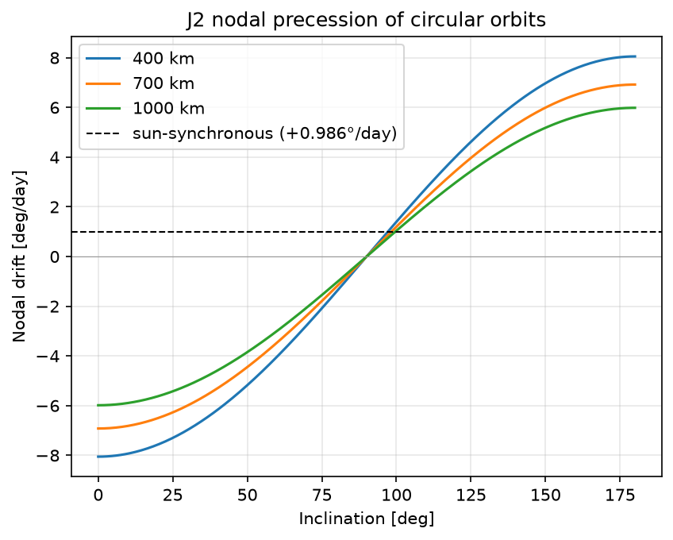
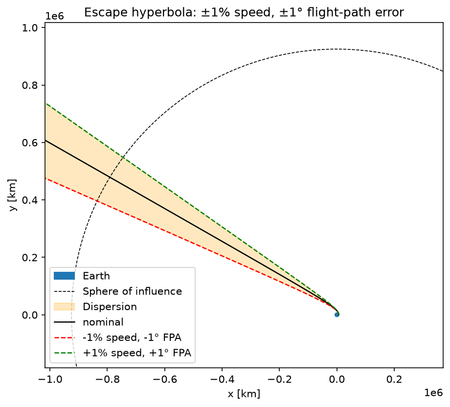
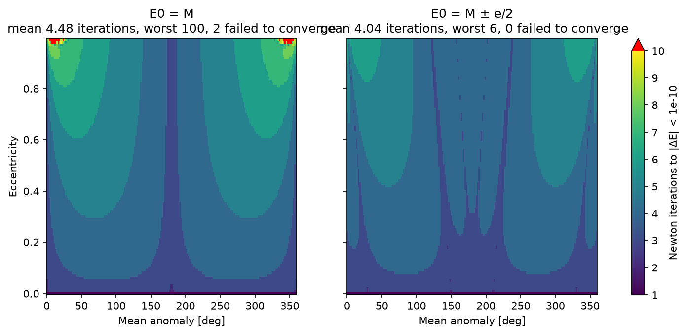
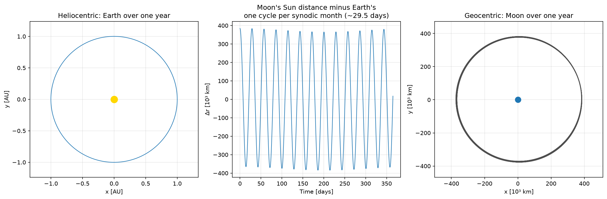

# orbital-mechanics

Small, readable orbital mechanics tools in Python: Kepler's equation for elliptic and hyperbolic
orbits, universal-variable propagation, J2 perturbations, ground tracks, and direct N-body integration.

This grew out of my second-year space engineering coursework at the University of Sydney and some
personal simulation projects. It's rewritten here as a standalone package with my own examples and
a test suite that checks every analytic propagator against direct numerical integration.



## What's in it

| Module | Contents |
|---|---|
| `orbitkit/kepler.py` | Newton solvers for elliptic and hyperbolic Kepler's equation, time-of-flight, anomaly conversions |
| `orbitkit/universal.py` | Stumpff functions, universal anomaly, state-vector propagation with Lagrange f and g |
| `orbitkit/elements.py` | Vis-viva and orbit relations, classical elements from a state vector, perifocal → ECI rotations |
| `orbitkit/perturbations.py` | Secular J2 drift of node and periapsis, sun-synchronous inclination |
| `orbitkit/groundtrack.py` | ECI → ECEF, latitude/longitude, wrap-safe ground track plotting |
| `orbitkit/nbody.py` | Vectorised 2D N-body equations of motion integrated with DOP853 |

## Examples

Run from the repo root, e.g. `python examples/sun_synchronous.py`.

**Sun-synchronous orbit design** (`examples/sun_synchronous.py`): solves for the inclination at
which J2 precesses the node by exactly 360° per year (98.19° at 700 km), then plots a day of ground
track (above) and how nodal drift varies with inclination and altitude.



**Departure dispersion** (`examples/departure_dispersion.py`): an escape hyperbola from a 300 km
parking orbit with v∞ = 3 km/s. Perturbing the burn by ±1% speed and ±1° flight-path angle shifts
when it reaches Earth's sphere of influence by −0.3 to +0.4 days and its direction by about ±5–6°.



**Choosing an initial guess for Kepler's equation** (`examples/kepler_convergence.py`): starting
Newton's method at E₀ = M fails to converge for some highly eccentric orbits near periapsis. Offsetting
the guess by ±e/2 converges everywhere in 6 iterations or fewer.



**Sun–Earth–Moon** (`examples/sun_earth_moon.py`): three-body integration over a year. Relative
energy drift is below 1e-13.



## Validation

```bash
pip install -r requirements.txt pytest
pytest
```

31 tests, including:

- Kepler solver residuals across e = 0 to 0.99 (elliptic) and e = 1.05 to 10, M from −50 to 50 (hyperbolic)
- Universal-variable propagation matches `scipy` integration of the two-body equations for circular,
  inclined elliptic and hyperbolic cases
- Energy and angular momentum are conserved, and propagating forward then back returns the start state
- Elliptic and hyperbolic Kepler propagation agree with universal-variable propagation
- The sun-synchronous inclination gives +0.9856°/day nodal drift, and the critical inclination (63.4°) freezes periapsis
- The N-body Moon stays bound to Earth and total energy drift stays below 1e-8

## Reference

H. D. Curtis, *Orbital Mechanics for Engineering Students*: the source for the universal-variable
formulation and J2 rate equations.
